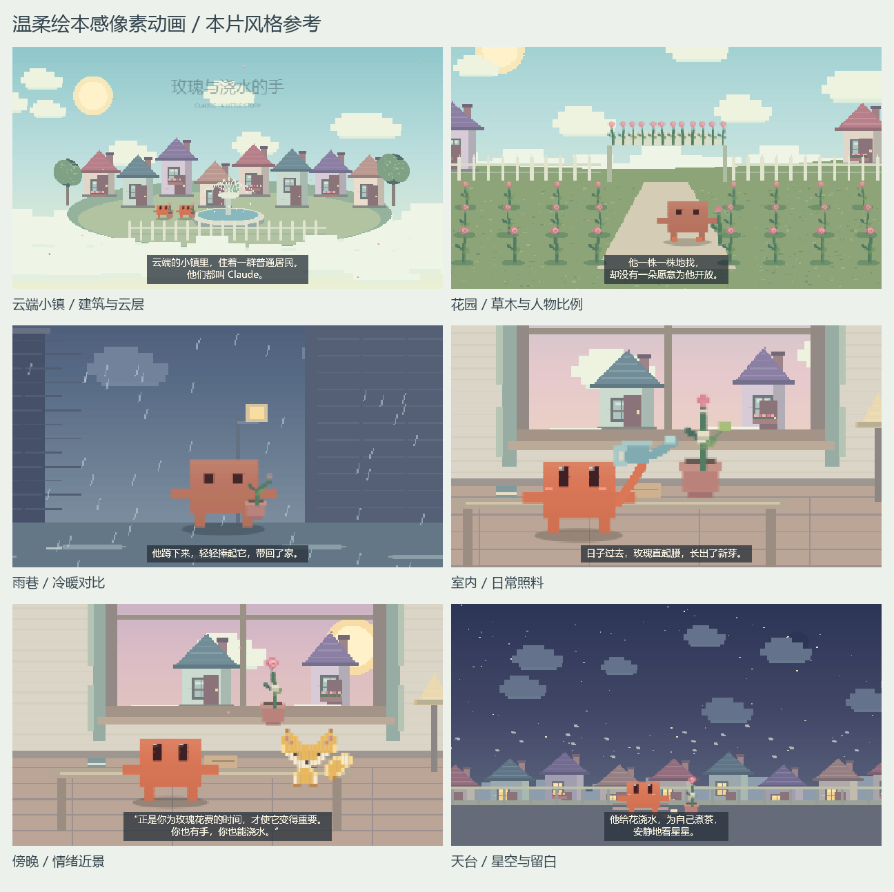

# Cozy Pixel Animation

温柔绘本感像素动画 skill，提炼自《玫瑰与浇水的手》的视频风格。

延续陶土红 Claude 小人、柔和多色场景、小幅度动作、缓慢推近和短叠化，让新故事拥有相近的视觉与观看体验。故事内容、时长和画幅可按需求调整。



## 内容

- `SKILL.md`：风格基准、角色连续性、分镜、字幕、声音与验收要求。
- `references/rendering.md`：Canvas 像素渲染、配色、动作、镜头、时间轴、声音与导出细节。
- `assets/style-board.png`：本片六种场景的视觉参考。
- `assets/sprite.js`：可复用的原版 Claude 角色素材。
- `agents/openai.yaml`：Codex skill 展示信息。

## 使用

将仓库克隆到 Codex 的 skills 目录：

```sh
git clone https://github.com/hudi0705/cozy-pixel-animation.git ~/.codex/skills/cozy-pixel-animation
```

Windows 的默认 skills 目录为 `%USERPROFILE%\.codex\skills`。也可下载仓库，解压后将包含 `SKILL.md` 的目录命名为 `cozy-pixel-animation`，放入 skills 目录。

在对话中调用：

```text
使用 $cozy-pixel-animation，把这个故事做成两分钟动画，
沿用温柔的像素绘本风，主角仍然是 Claude。
```

本仓库提供风格指导和角色参考素材；动画工程可用 Canvas 或其他动画工具实现。声音与视频导出按需使用浏览器渲染、Python 和 FFmpeg，细节见 `references/rendering.md`。
